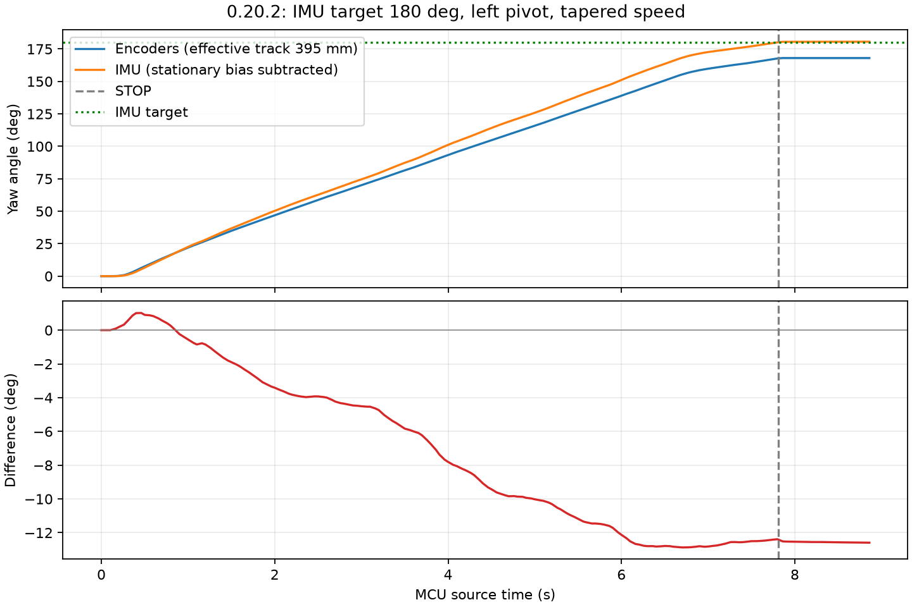

# 以 IMU 为准左转 180°：实测完成

2026-10-25，Asia/Singapore。用户指定 IMU 为角度依据，执行一次相对起始姿态的左转 180°。当前板上固件按用户报告为 0.20.2。本次由主机通过 USB 实时读取 IMU 并发送速度/STOP；未修改或烧录固件、未调整编码器几何、FF/PI 或 IMU 校准。

| 项目 | 结果 |
| --- | ---: |
| IMU 目标 | 180.000° |
| 在线达到目标、触发停车的 IMU 积分 | **180.045°** |
| STOP 后约 1 秒，同步窗口 IMU 积分 | **180.583°** |
| 以此计算的超转 | **+0.583°** |
| 同步窗口编码器转角 | **167.991°** |
| 约 3 秒停车观察结束时在线 IMU 积分 | 180.699° |
| MCU ACTIVE 时长 | 7.732 s |

已保持转向后的姿态，四轮停稳。故障 0/0，拒绝、CRC/溢出/丢包增量为 0，最后 STBY=0、四个 CCR=0，串口关闭。没有再次运动或反向修正。

## 控制与计时

转向前约 3 秒静止采样，去重后 307 个 IMU 样本，Z 均值 39.644951 mrad/s、标准差 0.952110 mrad/s。以此扣除静态零偏，按 IMU 源时间做梯形积分，重复样本不重复积分，缺失/失效/反向或通信异常立即终止。全程无缺失源样本。

以剩余角度控制主机速度：`min(0.40, max(0.20, 1.5 × remaining_rad))` rad/s；到达目标后直接 STOP，没有使用编码器作为停车依据。实际 124 条速度命令，范围 0.20–0.40 rad/s，最后速度为 0.20 rad/s；15 秒只是异常最长时限，达到角度后提前结束。

目标检测的 IMU 源时间为 1149060 ms；MCU 接到 STOP 的事件时间为 1149074 ms，相差 14 ms。MCU START=1141342 ms。输出关闭后仍有少量惯性转动，所以停车终点高于触发点。

为比较编码器，离线统一使用实际遥测时间 1141262–1150122 ms，包含 STOP 后约 1 秒收尾。编码器沿用 65 mm 轮径、1560 counts/rev、395 mm 有效轮距；LF/LR/RF/RR 净计数为 -4463/-4331/+4577/+4324，得到 167.991°。对应 IMU 为 180.583°，编码器少 12.593°（相对本次 IMU 约 6.973%）。

3 秒观察结束在线积分 180.699° 与停车后约 1 秒的 180.583° 使用不同结束时间，不能混为同一窗口。停车后基线均值 40.441935 mrad/s，相比转前改变约 0.797 mrad/s；若全窗口改用停车后基线，IMU 积分为 180.178°。这里保留转前基线作为实际控制依据，没有事后改写本次角度。之后如需提高精度，应另行验证零偏跟踪与停车惯性补偿。

## 证据

`capture/` 包含 USB/UART 原始数据、所有速度与 STOP 命令、逐帧遥测、TRACE、summary、一般诊断、同步转角 JSON/CSV 和 PNG/SVG。`scripts/` 保存实际工具及在线积分依赖，`result.json` 汇总目标控制结果。`capture_manifest.json` 记录本目录全部文件哈希，清单自身除外。

既有固件和之前所有采集保持原样。本次只执行一次运动，不以随后重试替换结果。
