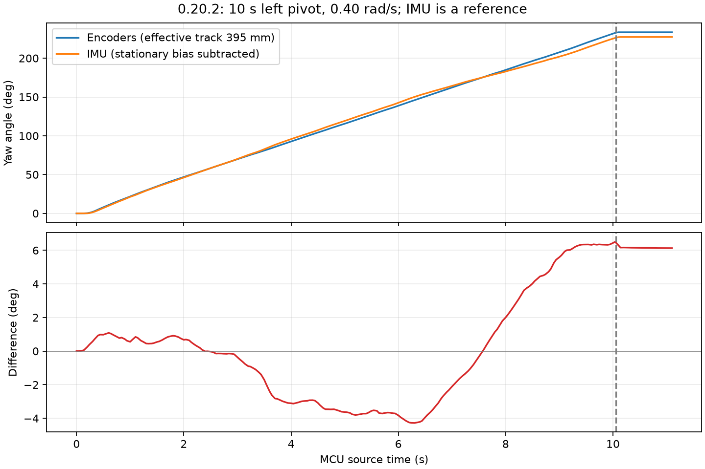

# 0.20.2：10 秒左转，编码器与 IMU 转角对照

2026-10-25，Asia/Singapore。按用户要求只执行一次 10 秒转向，选择左转 +0.40 rad/s。主机发令 10.000 s，MCU START 至 STOP 请求实际为 **9.992 s**。当前固件依据用户报告为 0.20.2；未复位读取启动横幅。COM4 为 USB CDC、COM8 为 CH340。

## 结果

| 指标 | 数值 |
| --- | ---: |
| 编码器转角 | **233.468°** |
| IMU 转角，扣除转向前静止零偏 | **227.337°** |
| 编码器减 IMU | **+6.131°** |
| 差值相对于 IMU 参考转角 | **2.697%** |
| 50 ms 对齐样本中最大绝对差值 | 6.506°，相对窗口起点 10.040 s |
| IMU 改用转向后零偏计算 | 227.251° |
| 前后零偏选择造成的角度变化 | 0.086° |

转向前后各采集约 3 秒静止数据。去掉重复源样本后，转向前 307 个样本覆盖 3060 ms，Z 零偏均值 41.061889 mrad/s、标准差 0.891188 mrad/s；转向后 310 个样本覆盖 3089 ms，均值 41.196774 mrad/s、标准差 1.181848 mrad/s。summary 的在线均值包含重复发送的源样本，本报告统一采用离线去重后的均值。

同一窗口内 IMU 未扣本次零偏的积分为 253.452°；因此直接使用未校准积分会混入明显零偏。保存的 IMU 校准偏置当前无效，本次没有修改校准或写入 Flash。IMU 是参考，没有外部角度真值，不能把两者差值直接判为某一传感器的真实误差。



差值随时间变化，在约 6.3 秒为 -4.276°，随后转为正值，终点为 +6.131°。它不是简单恒定比例误差；不能仅按单次终点比例修改轮距。架空/落地物理条件未明确，仍记录为 unspecified。

## 时间和计算方法

MCU START=684562 ms，STOP 请求=694554 ms。比较窗口统一取实际编码器遥测时间 **684502–695602 ms**，共 11.100 s，包含转向前短静止和 STOP 后约 1 秒收尾，避免把两个传感器的停车尾段错开比较。

编码器端点全部来自实际累计计数，未改写、缩放原始计数或补数。LF/LR/RF/RR 净计数为 **-6145/-6074/+6265/+6108**。几何沿用轮径 65 mm、1560 counts/rev、有效轮距 395 mm：

`yaw_rad = ((RF + RR) / 2 - (LF + LR) / 2) × (π × 0.065 / 1560) / 0.395`

IMU 使用相同窗口的源时间戳做梯形积分，先扣除去重后的静止 Z 均值；仅窗口边界的角速度采用相邻样本线性插值。源采样最大间隔 10 ms，没有遗漏源样本或读取错误增量。独立实现重新计算了边界积分及编码器公式，结果吻合。

主机命令按 MCU ACTIVE 时长积分为 229.000°。这只是命令参考，没有替代任何实测值。完整 USB 遥测覆盖整个运动；128 帧 TRACE 只覆盖末尾约 2.5 秒，不能把末尾 TRACE 当作全程。

## 状态和待标定项

全程故障 0/0，命令拒绝、主机 CRC、设备 CRC/溢出/丢包增量均为 0。反馈年龄、输出关闭、编码器配置及停车检查通过。结束时四轮零速、STBY=0、四轮 CCR=0，串口已关闭，没有清故障、复位、烧录或调整参数。

末尾 TRACE 的方向归一化均速 LF/LR/RF/RR 为 607.35/604.84/611.46/617.98 cps，目标约 603 cps；RF 有 34 个末尾 ACTIVE 样本达到 I=50‰。这仍支持后续进行带载前馈与积分余量标定，不依据本次单一速度数据自动改参。供电为 10.406–10.791 V。

首次延长静止采样时，脚本只发送一次 GET_STATUS，保活不足导致遥测超时，运动次数为 0，记录保存在 `preflight_without_motion/`。修正为基线期间持续查询后执行了本次唯一运动。没有隐藏失败记录或重复运动。

`capture/` 保存原始 USB/UART、逐帧数据、发令序列、TRACE、summary、一般诊断、`yaw_comparison.json`、`yaw_curve.csv` 和 PNG/SVG 曲线；`result.json` 汇总最终对照；`scripts/` 保存本次工具副本。`capture_manifest.json` 记录本目录全部文件哈希，清单自身除外。

离线复算，无设备访问：

```powershell
python -B Tools/compare_encoder_imu_yaw.py build/hardware_tests/v0202_left_explicit_20261025_055158_390348 --plot
```
